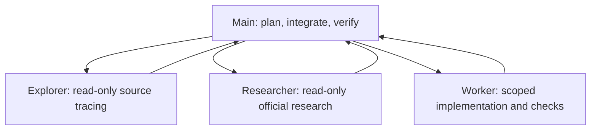

# Codex workspace template

A reusable instruction and agent setup for a single repository, a monorepo, or a
workspace containing independent projects. It keeps shared rules in one short
`AGENTS.md`, project contracts close to their code, and task state outside the
always-loaded instructions.

The default structure has one main orchestrator and three specialized roles:



Only main delegates. Children do not create more children. The included config
bounds concurrency and depth; model IDs and reasoning effort are explicit in the
TOMLs and can be changed for the models available to an adopting account.
There are no project, language, framework, operating-system or cloud-provider
requirements in the instruction policy. The optional helper needs Python 3.11+
and symlink support; the export tool also needs Git.

## Choose a layout

| Layout | Adoption |
| --- | --- |
| One repository | Copy `.codex/`, adapt root `AGENTS.md` to index source areas, and copy `docs/workflow.md` plus its referenced templates. |
| Monorepo | Keep shared rules/config at the Git root; adapt the example `AGENTS.md` for packages that need distinct commands or contracts. |
| Independent repositories in a workspace | Keep a canonical workspace `.codex/` and root index; give each project its own guide and use the explicit link helper below if shared defaults are appropriate. |

Start from GitHub's **Use this template** action, or clone/copy this repository.
For an existing project, review and merge its instructions/configuration instead
of overwriting them. Keep linked documentation paths valid when copying files.
Do not copy private global Codex configuration, authentication or session data.

1. Adapt the project index in [AGENTS.md](AGENTS.md).
2. Give each owning project a guide based on [the project example](examples/project/AGENTS.md).
3. Review [the config](.codex/config.toml) and the three role TOMLs for account/client compatibility.
4. Keep task notes local, then run the validation commands below.
5. Start a fresh Codex session in the actual working directory and verify loaded
   instruction files and the custom agent catalog. Review any Folder access trust
   prompt yourself; this repository's tools never change saved trust or permissions.

Codex normally discovers instructions from the project root, often a Git root,
toward the working directory. An independent nested repository may omit its outer
workspace. Give that project's guide an explicit relative reference to the
workspace guide if it should apply. Sharing config does not load outer Markdown
instructions. Project config requires a trusted project. See the official
[AGENTS.md discovery guide](https://learn.chatgpt.com/docs/agent-configuration/agents-md)
and [configuration guide](https://learn.chatgpt.com/docs/config-file/config-basic).

## Shared defaults for independent projects

Run from this template or an adopted copy, replacing the example locations:

```sh
python3 scripts/link_workspace.py --workspace "/path/to/workspace" project-a "project b"
python3 scripts/link_workspace.py --workspace "/path/to/workspace" --apply project-a "project b"
```

The first command previews without writing. Apply creates relative links for
`.codex/config.toml` and `.codex/agents` only in the explicitly named, existing
projects inside that workspace. The helper preflights all destinations, refuses
conflicting files or links and symlinked `.codex` directories, and rolls back newly
created links on a write failure. Repeating a matching plan is idempotent.
It never discovers projects recursively or edits global configuration or trust.

A linked project shares both settings and roles. If it needs custom configuration,
merge the needed defaults deliberately and manage it independently; the helper
manages config and agents as a pair. Keep these local links out of independent
public repos through `.git/info/exclude`, for example:

```gitignore
/.codex/config.toml
/.codex/agents
/.codex/tasks/
```

On Windows, symlink creation may require Developer Mode or elevated privileges.
If symlinks are unavailable, copy and deliberately maintain the small configuration
files instead. The helper reports failures; it does not change OS permissions.
Move a linked workspace together, or recreate its links after moving projects.
Unlink only the known managed links when removing local sharing.

## Workflow and context

[docs/workflow.md](docs/workflow.md) defines delegation, ownership, escalation and
resume behavior. Use [a delegation brief](docs/templates/delegation.md) for fresh
subagent context and [a task-state note](docs/templates/task-state.md) for sustained
work. Notes stay in `.codex/tasks/<slug>.md`, one file per task, excluded from Git.

The roles preserve read-only exploration/research, scoped implementation, a
bounded failed-fix escalation rule and concise evidence-based handoffs. Main
checks results independently. See the official
[subagent documentation](https://learn.chatgpt.com/docs/agent-configuration/subagents)
for custom-agent fields, configuration precedence and inherited permissions.

Small guides and focused notes reduce repeated context loading. They do not
promise lower billed tokens, better model quality or lossless context. Independent
subagents also consume tokens. Do not increase context limits or force compaction
thresholds just to make an oversized guide fit.

## Repository map

| Path | Purpose |
| --- | --- |
| [AGENTS.md](AGENTS.md) | Shared rules and project index |
| [Example project guide](examples/project/AGENTS.md) | Project-owned setup, boundaries and validation |
| [Codex config](.codex/config.toml) | Main/default models and concurrency/depth limits |
| [Explorer](.codex/agents/explorer.toml), [researcher](.codex/agents/researcher.toml), [worker](.codex/agents/worker.toml) | Canonical role instructions and model/effort settings |
| [Workflow](docs/workflow.md) | Delegation, context continuity and maintenance |
| [Task state](docs/templates/task-state.md), [delegation brief](docs/templates/delegation.md) | Local context/handoff formats |
| [Link helper](scripts/link_workspace.py) | Explicit preview-first nested configuration sharing |
| [Validator](scripts/validate_template.py) | Structure, links, TOMLs, privacy patterns and byte budgets |
| [Exporter](scripts/export_template.py) | Clean source ZIP from an immutable Git commit |
| [Validator tests](tests/test_validate_template.py), [link tests](tests/test_link_workspace.py), [export tests](tests/test_export_template.py) | Standard-library regression coverage |
| [CI](.github/workflows/validate.yml) | Validation and tests with read-only repository permissions |
| [Contributing](CONTRIBUTING.md), [license](LICENSE) | Maintenance guidance and MIT license |

## Validate and export

Python 3.11 or newer is required. No third-party Python dependencies are needed.
From the repository root:

```sh
python3 scripts/validate_template.py
python3 -m unittest discover -s tests -v
```

Validate a copied template with `python3 scripts/validate_template.py --root PATH`.
The validator checks role/config field shapes without pinning model IDs, Markdown
routes, privacy patterns and instruction-size budgets: root at most 6 KiB, example
project at most 8 KiB, combined example chain at most 24 KiB. These budgets are
smaller than Codex's documented default project-document cap of 32 KiB. They are
byte guardrails, not token counts or full runtime compatibility checks.
The validator targets the complete template repository or a copy of it. After
adopting selected files into another project, use that project's own checks and
verify configuration loading in its Codex client.

After committing the reviewed source, create a clean ZIP outside the repository.
The output directory must exist and its filesystem must support hard links:

```sh
python3 scripts/export_template.py --output /path/to/review/codex-workspace-template.zip
```

The exporter uses committed `HEAD`, excludes Git metadata and untracked files,
validates the exported source, and reports the commit it exported. Review a clean
export before publication. Pattern checks cannot identify every personal detail
in arbitrary prose, so inspect docs, fixtures and commit metadata too.

## Publication

Use GitHub's Template repository setting to make this setup reusable through
**Use this template**. Repository visibility is a separate owner decision.
When preparing a public copy:

- Use generic examples and project-owned instructions; remove workstation paths,
  real organization/project details, private inputs and generated runtime state.
- Keep credentials, global configuration, sessions, actual task notes, model files
  and private evidence out of both source and Git history.
- Validate the committed source and its clean export. Use a deliberate public
  commit identity when preparing history for distribution.
- Keep the chosen license and review repository settings before changing visibility.
